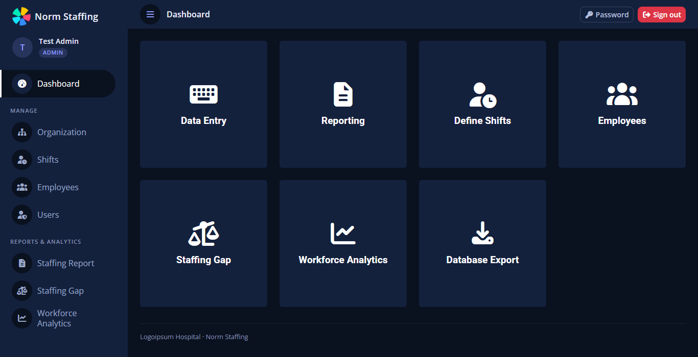
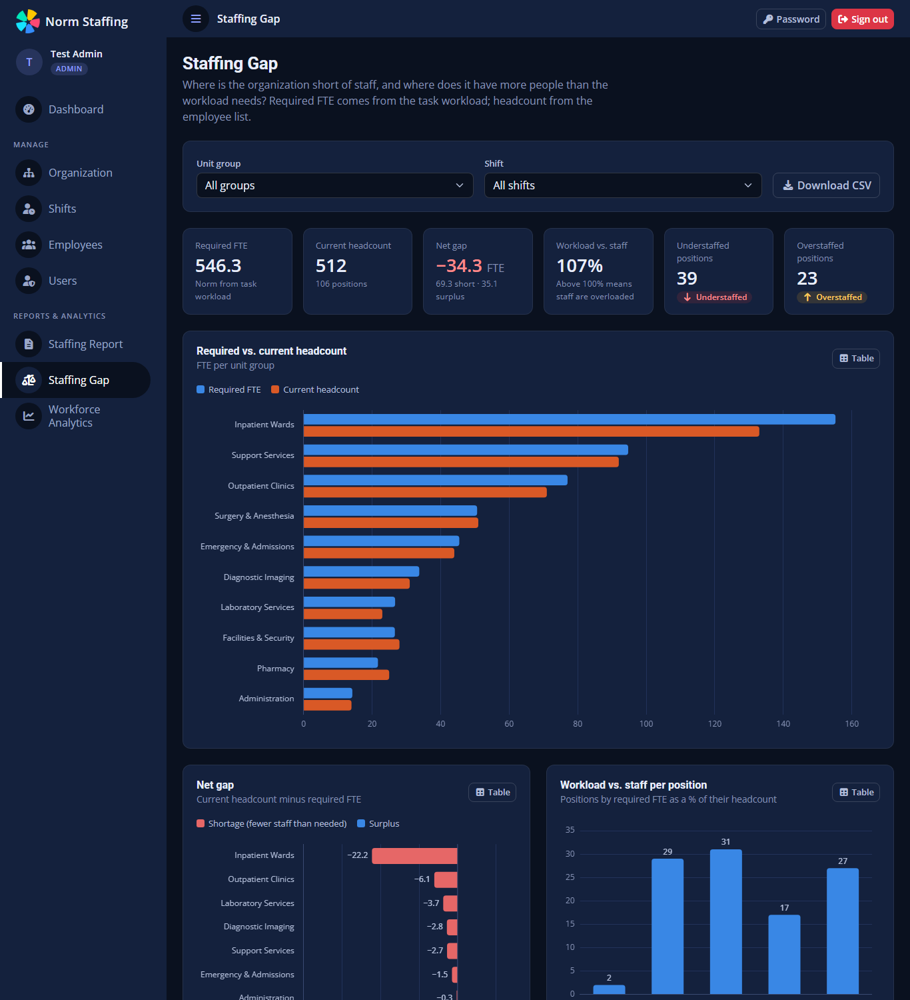

# Norm Staffing Website

> [!WARNING]
> **Disclaimer: UI, function and file names are translated from project's original language to English using AI. May include wrong information.
---
>[!NOTE]
>Click [Here to See Live Demo](https://hrdemo.samiaktug.dev/index.php) of Website
---
Workload-based headcount planning and personnel management for hospitals and other
shift-based organizations, with built-in analytics.

Every **position** has a list of **tasks**: how long one item takes and how often it occurs per
day, week or month. From that the app calculates how many people the position needs
(**required FTE**) and compares it with the employees actually assigned to it.



## Features

- **Organization**: unit groups → units → positions → tasks in a column browser. Rename, move,
  change a position's shift, edit tasks, copy tasks from a similar position.
- **Shifts**: start/end time, days per week and effective (productive) hours per person.
- **Employees**: searchable, sortable staff list with hire and departure dates and contract types.
- **Staffing Report**: norm vs. actual headcount, drill-down from organization to position,
  task-level calculation, print view.
- **Staffing Gap** (analytics): required vs. current headcount by group or unit, net shortage /
  surplus, workload distribution, most under- and overstaffed positions, CSV download.
- **Workforce Analytics**: headcount trend, hires vs. exits, annualized turnover, tenure, age
  structure, reasons for leaving, contract mix, turnover by group.
- **Users and roles**: administrators edit data and manage users; viewers read reports and analytics.
- **Exports**: whole database as CSV (zip) or Excel.



The repository ships with fictional sample data (*Logoipsum Hospital*: 10 unit groups,
49 units, 106 positions, 550 tasks and about 700 employees).

## Quick start (Docker)

Requirements: Docker with Docker Compose.

```bash
cp .env.example .env          # then set DB_PASSWORD (and TZ) in .env
docker compose up -d --build
docker compose exec web php bin/create-user.php admin
```

The last command asks for a full name and a password and creates the first administrator.
There is **no default account**. Open <http://localhost:8080> and sign in. Further users are added
on the **Users** page.

The first start installs the PHP dependencies (`composer install`) and loads
`database/schema.sql` and `database/seed.sql` into the database.

### Useful commands

```bash
# Run the tests
docker compose exec web php tests/run.php

# Reset the database to the sample data (deletes all data and users)
docker compose down -v && docker compose up -d

# Regenerate the sample data (deterministic)
docker compose exec -T web php database/generate-seed.php > database/seed.sql

# Check PHP dependencies for known vulnerabilities
docker compose exec web composer audit
```

To start with an empty organization instead of the sample data, remove the `02-seed.sql` line from
`docker-compose.yml` before the first start.

## Running without Docker

- PHP ≥ 8.3 with `pdo_mysql`, `zip`, `gd`, `mbstring`, `xml`
- MariaDB ≥ 10.6 or MySQL ≥ 8.0
- Composer

1. Run `composer install --no-dev`.
2. Create a database, then load `database/schema.sql` (and optionally `database/seed.sql`).
3. Point the web server's document root at `public/`. Nothing outside `public/` may be served.
4. Set the environment variables below.
5. Run `php bin/create-user.php <username> admin`.

## Configuration

| Variable                            | Default                    | Meaning                                                                     |
| ----------------------------------- | -------------------------- | --------------------------------------------------------------------------- |
| `APP_NAME`                          | `Norm Staffing`            | Product name shown in the UI                                                |
| `ORG_NAME`                          | `Logoipsum Hospital`       | Organization name shown in the UI                                           |
| `TZ`                                | `UTC`                      | Time zone that decides what "today" is (active employees, turnover periods) |
| `DB_HOST`, `DB_PORT`                | `db`, `3306`               | Database server                                                             |
| `DB_NAME`, `DB_USER`, `DB_PASSWORD` | `db` (Docker: from `.env`) | Database credentials                                                        |
| `APP_PORT`                          | `8080`                     | Docker only: port the app is published on                                   |

Replace the placeholder logo (`public/assets/img/logo.png`, favicons) with your own; see
[THIRD\_PARTY\_NOTICES.md](THIRD_PARTY_NOTICES.md).

## How the norm is calculated

Implemented once in [`src/Workload.php`](src/Workload.php) and used by the reports, the analytics
pages and the seed generator. Tests: [`tests/run.php`](tests/run.php).

For each task:

- **mean load (min/day)** = average duration × average frequency. Weekly counts are divided by the
  shift's active days; monthly counts by 21 working days.
- **standard deviation**: the load is treated as a random sum of N items (N uniform between the
  frequency min and max), each taking D minutes (D uniform between the duration min and max), so
  Var = E\[N]·Var(D) + Var(N)·E\[D]². Day, week and month bands are independent, so their variances add.
- **safety time** = mean + 1.5 × standard deviation.
- **standard time** = safety time + mean × (personal % + rest %) / 100.

For each position:

- **required FTE** = Σ standard time ÷ (effective hours × 60) × coverage factor.
- **coverage factor** = shift days per week ÷ 5. One person works 5 days a week, so a 7-day shift
  needs 1.4 people for every daily slot. Change `Workload::WORK_DAYS_PER_EMPLOYEE` if your
  contracts differ.
- **headcount** = employees assigned to the position whose departure date is not in the past.
- A position is *balanced* when |headcount − required| < 0.5 FTE.

## Project layout

```javascript
public/                web root: the only folder that may be served
  index.php            sign-in page
  app/                 pages
  app/api/             JSON endpoints (GET / POST / PATCH / DELETE)
  assets/              CSS, JS, fonts, images, vendor libraries
src/                   bootstrap (config, DB, JSON helpers), auth, layout, Workload, StaffingService
bin/create-user.php    create accounts from the command line
database/              schema.sql, seed.sql, generate-seed.php
docker/                PHP 8.3 + Apache image
tests/run.php          dependency-free tests for the calculation
```

## Security

Built in:

- **Accounts:** stored in the database with `password_hash()` (minimum 10 characters). There are
  no default credentials.
- **Sign-in throttling:** after 5 failed attempts for a username, or 30 from one IP address, sign-in
  is refused for 15 minutes.
- **Sessions:** HttpOnly + SameSite cookies, regenerated at sign-in. Changing or resetting a password
  ends the user's other sessions, and disabled users are signed out immediately.
- **Access checks:** every API call requires a session. Changes and exports need the admin role and
  a CSRF token.
- **Input and output:** all output is escaped, and user input reaches SQL only through prepared statements.
- **Privacy:** viewers do not receive employees' birth dates or gender.

Before using it with real data:

- **HTTPS:** serve it over HTTPS, for example behind a reverse proxy, and keep it on your internal network or VPN.
  Behind a proxy all requests share the proxy's IP address, so the per-IP sign-in limit applies to everyone together.
- **Credentials and backups:** use a strong `DB_PASSWORD` and back up the database volume.
- **Data protection:** check what personal data you store against your data-protection rules (GDPR / KVKK).

## License

[MIT](LICENSE). Third-party components and their licenses are listed in
[THIRD\_PARTY\_NOTICES.md](THIRD_PARTY_NOTICES.md).
